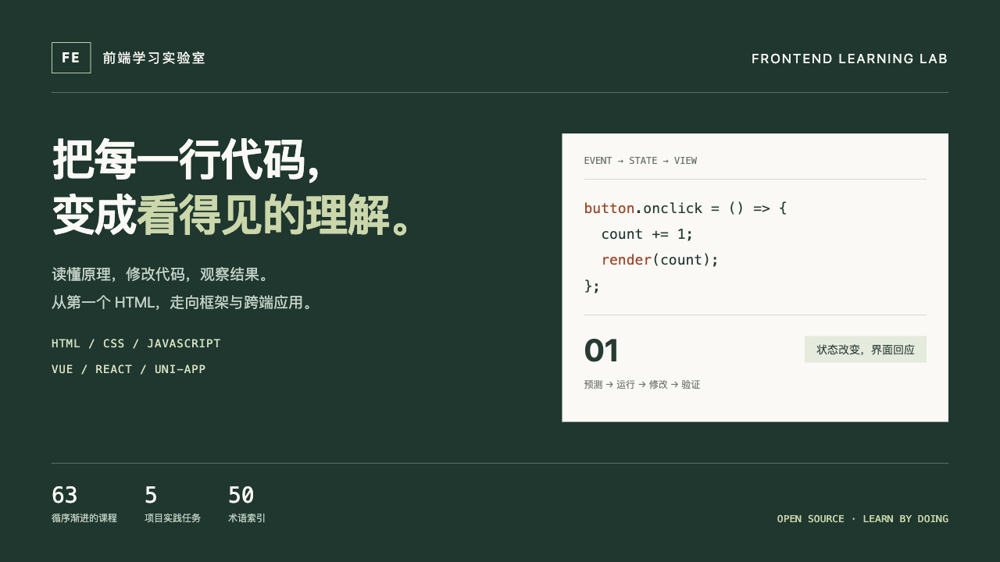

# 前端学习实验室 · Frontend Learning Lab

**把每一行代码，变成看得见的理解。**



面向想系统学习前端的程序员的中文交互式学习项目。从 HTML、CSS、JavaScript 的协作开始，通过可编辑代码、真实运行结果、逐步讲解与练习反馈，进入 Vue、React 和 uni-app。

## 为什么做这个项目

看懂教程，不一定能独立写出页面。这里将学习组织为一条可反复验证的路径：

**理解原理 → 预测结果 → 运行代码 → 修改实验 → 完成检查 → 复习与项目实践。**

特别适合已经有编程经验、希望建立前端思维的后端工程师，也适合希望补齐基础的前端学习者。

## 可以学到什么

| 路线 | 主要内容 |
| --- | --- |
| 浏览器与页面 | HTML 入口、资源加载、DOM、语义与表单 |
| CSS 与设计 | 盒模型、层叠、Flex/Grid、响应式、需求与 Figma 拆解 |
| JavaScript | 数据转换、闭包、事件循环、状态、异步请求与竞态 |
| 应用与交付 | 模块、路由、状态组织、安全、性能、质量与发布 |
| Vue | 响应式、SFC、组件契约、watch、Router、Pinia、KeepAlive |
| React | 渲染快照、组件身份、Effect、ref、表单、Context、memo、Suspense |
| uni-app | 编译目标、工程入口、页面生命周期、页面栈、请求、分页与跨端验收 |

目前包含 **63 课、5 个项目实践任务、50 个术语条目**。框架进阶课程提供 **60 段深入理论和 30 份工程源码对照**。另有 Flutter 拓展内容；它不是完整 Flutter 开发环境。

## 本地运行

先克隆仓库：

```sh
git clone https://github.com/ayogggua/frontend-learning-lab.git
cd frontend-learning-lab
```

只需要静态 HTTP 服务，无须安装前端依赖或进行构建。以 Python 3 为例，在项目根目录执行：

```sh
python3 -m http.server 4311 --bind 127.0.0.1
```

打开 <http://localhost:4311/>，框架专题位于 <http://localhost:4311/#frameworks>。

如果端口已被占用，换成 4312 等空闲端口。请通过 HTTP 访问，不要直接双击 index.html：教学运行时通过 fetch 加载，file:// 会受到浏览器限制。

也可以部署到支持静态文件的托管服务。保留目录结构即可，站内导航采用 URL hash，不需要后端路由回退。

## 建议学习方式

1. 从“三个文件怎样连起来”开始，分别关闭 CSS、JS，观察结构、样式和行为的边界。
2. 阅读执行跟读，点击代码行查看说明；先预测，再运行。
3. 编辑代码并重新运行，在 Console 和 DOM 面板对照结果。
4. 完成动手练习和理解题，记录自己原先的误解。
5. 选择 Vue 或 React 深入；学习 uni-app 前先完成 Vue 基础。
6. 按项目实践的验收标准交付自己的作品，并记录证据。

部分示例故意包含错误，供你诊断与修复。练习检查通常验证当前可观察结果，不等同于完整工程测试或对掌握程度的认证。

## 功能与运行边界

- HTML / CSS / JS 编辑、独立 iframe 预览、日志与 DOM 观察、示例导出。
- 原生 JavaScript、Vue 和 React 课程在浏览器中实际执行。
- Vue Router 课使用内存历史，避免修改平台自己的地址。
- **uni-app 使用原生 JS 机制模型，不执行 uni-app 编译器、小程序或 App 运行时。** 工程片段需要放入真实工具链，并在目标设备验收。
- SFC、JSX、配置文件属于工程源码对照，不会直接在普通 JS 面板中执行；这些片段不是完整脚手架。
- 预览沙箱阻止外部网络请求；接口课程使用本地教学数据。导出的 HTML 是普通可执行页面，不再具有平台预览的相同沙箱限制，请审查代码后运行。
- 没有账号系统、服务端数据库或云同步。课程包含官方资料链接，访问这些资料需要联网。

## 学习记录与隐私

进度、代码草稿、笔记、收藏、复习安排和项目自评保存在当前站点的浏览器 localStorage 中。数据不会由本项目自动上传。

学习中心支持导出 JSON 备份、校验后导入和冲突合并。换浏览器、换域名/端口或清除站点数据时，原记录不会自动跟随，请提前备份。备份可能包含你输入的私有代码和笔记，请勿提交到公开仓库。

## 项目结构

```text
index.html                 页面与脚本入口
style.css                  页面样式
app.js                     编辑器、沙箱执行、检查与导航
curriculum*.js             基础与进阶课程数据
framework-{vue,react,uni}.js 框架理论、实验与工程片段
framework-content.js       框架路线、项目与术语扩展
framework-ui.js            框架专题与源码阅读界面
learning*.js               学习中心、进度、复习与备份
vendor/                    固定版本教学运行时及许可证
assets/                    海报 HTML 源稿和 PNG
```

## 参与贡献

欢迎通过 Issue 提出错误、课程建议和练习改进，通过 Pull Request 提交修改。

新增课程时请沿用稳定且唯一的课程 id，不要随意更改已有 id，以免破坏学习记录。课程应包含：前置知识、原理、可运行示例、操作步骤、可观察验收条件、提示、理解题和官方参考。明确区分真实运行与教学模拟。

提交前请实际运行涉及的课程，验证正常路径、错误路径、检查反馈和窄屏布局。不要提交凭据、个人学习备份、调试产物或未经授权的第三方素材。更换 vendor 版本时同步验证课程兼容性并更新许可证。

## 许可证

项目原创代码、课程内容与海报采用 [MIT License](LICENSE)。第三方运行时保留各自版权与许可证，见 [第三方说明](vendor/NOTICE.md)。教学固定版本不代表最新版本。
